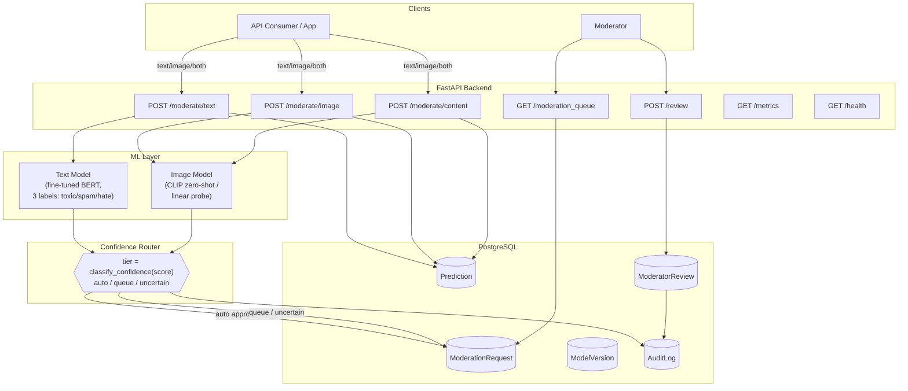

# Content Moderation Pipeline

A production-grade, AI-powered content moderation system for text and images.

- **Text moderation** — fine-tuned BERT, multi-label classification (`toxic`, `spam`, `hate`)
- **Image moderation** — CLIP zero-shot classification (`nsfw`, `violence`, `weapons`, `hate_symbols`, `graphic_content`), upgradeable to a trained linear probe as review data accumulates
- **Confidence-based routing** — configurable three-tier policy (auto-resolve / moderator queue / manual review)
- **Human-in-the-loop** — a real moderation queue backed by Postgres, with full audit logging
- **Weekly automated retraining** — merges moderator decisions into training data, retrains, evaluates, and only promotes a new model if it's actually better
- **FastAPI backend**, **React frontend tester**, **Streamlit dashboard**, **MLflow** experiment tracking, **Docker Compose** deployment, **Alembic** migrations, and a **pytest** suite

---

## Text Moderation: 3-Label Model

The text moderation model classifies text into three independent categories using a fine-tuned BERT model:

| Label | Index | Description |
|---|---|---|
| `toxic` | 0 | General toxicity: insults, severe language, abusive content |
| `spam` | 1 | Spam, phishing, scams, unsolicited commercial content |
| `hate` | 2 | Hate speech: identity-based attacks, threats, discrimination |

These are **not mutually exclusive** — a text can be simultaneously toxic and hateful, or both toxic and spam. The model outputs three independent sigmoid probabilities:

```json
{
  "toxic": 0.92,
  "spam": 0.04,
  "hate": 0.87
}
```

### Architecture

```
Text
  ↓
Tokenizer (BERT, max_length=256)
  ↓
Pretrained BERT encoder (bert-base-uncased)
  ↓
3-output classification head (linear layer)
  ↓
BCEWithLogitsLoss (multi-label, with label masking)
  ↓
Sigmoid (at inference)
  ↓
Toxic probability, Spam probability, Hate probability
```

### Decision Logic

| Probability Range | Decision |
|---|---|
| ≥ 0.80 | **Flagged** — high confidence that this category is present |
| ≤ 0.20 | **Safe** — high confidence that this category is absent |
| 0.20 – 0.80 | **Uncertain** — requires manual review |

Thresholds are configurable via environment variables.

### Dataset Construction

The unified training dataset (`data/text_moderation_dataset.csv`) is built from two source datasets:

**Source A: `data/toxic_hate.csv`** (Jigsaw Toxicity Dataset, ~160K rows)
- Columns: `id, comment_text, toxic, severe_toxic, obscene, threat, insult, identity_hate`
- **toxic** = max(toxic, severe_toxic, insult) — any of these sub-labels indicates toxicity
- **hate** = max(identity_hate, threat) — identity-based attacks and threats
- **spam** = unknown (masked out during training)

**Source B: `data/spam.csv`** (SMS Spam Collection, ~5.5K rows)
- Columns: `v1` (spam/ham), `v2` (text)
- **spam** = 1 if v1="spam", 0 if v1="ham"
- **toxic** = unknown (masked)
- **hate** = unknown (masked)

**Label masking**: When a label is unknown for a row (e.g., spam data has no toxic labels), the training loss masks it out so the model does not learn false negatives. The sentinel value `-1` indicates "unknown label."

To rebuild the unified dataset:
```bash
python scripts/build_text_dataset.py
```

### Training

```bash
# Full training on the unified dataset (recommended)
python -m scripts.train_text_model \
    --data-path data/text_moderation_dataset.csv \
    --output-dir models/text_moderation \
    --epochs 4

# Quick training on a subset (for testing the pipeline)
python -m scripts.train_text_model \
    --data-path data/text_moderation_train_subset.csv \
    --output-dir models/text_moderation \
    --epochs 2
```

Training parameters (configurable):
- `--batch-size 16` (default: 16)
- `--learning-rate 2e-5` (default: 2e-5)
- `--epochs 4` (default: 4)
- `--max-length 256` (default: 256)
- `--warmup-ratio 0.06` (default: 0.06)
- `--early-stopping-patience 3` (default: 3)

The trained checkpoint is saved to `models/text_moderation/` and loaded by the API at startup.

**Important**: The model must be trained before starting the API. If no checkpoint exists, the API will fail with a clear error message telling you to run the training script.

### Data Splitting

- 70% training
- 15% validation (for early stopping)
- 15% test (held out, never seen during training)

Unknown labels (-1) are masked in the loss function.

### Evaluation

Each label is evaluated independently:
- Precision, Recall, F1-score per label
- PR-AUC per label
- Macro and micro aggregates
- Confusion matrices per label
- Detailed classification report

---

## Architecture Overview



---

## Project Structure

```
content-moderation-pipeline/
├── app/
│   ├── api/                  # FastAPI route handlers
│   │   ├── deps.py           #   dependency-injected DB/model/router accessors
│   │   ├── moderation.py     #   POST /moderate/{text,image,content}
│   │   ├── queue.py          #   GET /moderation_queue, POST /review
│   │   └── system.py         #   GET /metrics, GET /health
│   ├── core/
│   │   ├── config.py         # Settings (env-driven), incl. routing thresholds
│   │   └── logging_config.py # structured logging setup
│   ├── db/
│   │   ├── database.py       # SQLAlchemy engine/session, get_db(), session_scope()
│   │   └── models.py         # User, ModerationRequest, Prediction, ModeratorReview,
│   │                         #   ModelVersion, AuditLog
│   ├── ml/
│   │   ├── text_moderation.py   # TextModerationModel (BERT, 3 labels)
│   │   ├── image_moderation.py  # ImageModerationModel (CLIP: zero-shot + linear probe)
│   │   └── metrics.py           # shared multi-label precision/recall/F1/confusion-matrix
│   ├── schemas/               # Pydantic models (ML I/O, routing, API contracts)
│   ├── services/
│   │   ├── routing.py             # ConfidenceRouter (the 3-tier policy)
│   │   ├── queue_service.py       # human-in-the-loop workflow + audit logging
│   │   ├── model_registry.py      # model versioning + promote-if-better
│   │   └── analytics_service.py   # shared stats used by /metrics AND the dashboard
│   ├── utils/file_storage.py  # image upload handling
│   └── main.py                 # FastAPI app factory
├── dashboard/app.py            # Streamlit dashboard
├── frontend/                   # React/Vite text + image moderation tester
├── scripts/
│   ├── build_text_dataset.py   # Build unified text training dataset
│   ├── train_text_model.py     # BERT fine-tuning (HF Trainer)
│   └── train_image_model.py    # CLIP linear-probe training
├── retrain.py                  # weekly orchestrator: merge → train → promote → version
├── alembic/                    # DB migrations
├── configs/model_config.yaml   # model hyperparameters, label lists
├── docker/                     # Dockerfiles
├── docker-compose.yml          # full stack
├── tests/                      # pytest suite
├── data/
│   ├── toxic_hate.csv          # Jigsaw toxicity source dataset
│   ├── spam.csv                # SMS Spam Collection source dataset
│   ├── text_moderation_dataset.csv  # Unified 3-label training dataset
│   └── uploads/                # Image upload storage
├── models/
│   ├── text_moderation/        # Trained BERT checkpoint (3 labels)
│   ├── bert-base-uncased/      # Cached base BERT weights
│   └── image_moderation/       # CLIP model + optional linear probe
├── .env.example
├── requirements.txt
└── Makefile
```

---

## Quick Start

### 1. Build the unified dataset

```bash
python scripts/build_text_dataset.py
```

This creates `data/text_moderation_dataset.csv` from the two source datasets.

### 2. Train the text model

```bash
python -m scripts.train_text_model \
    --data-path data/text_moderation_dataset.csv \
    --output-dir models/text_moderation \
    --epochs 4
```

Note: Training BERT on CPU is slow (~20 seconds per batch). For faster training, use a GPU or reduce the dataset size. The model checkpoint is saved to `models/text_moderation/`.

### 3. Start the API

```bash
# Set the text labels in .env
# TEXT_LABELS=["toxic","spam","hate"]

uvicorn app.main:app --reload --host 0.0.0.0 --port 8000
```

### 4. Start the frontend

```bash
cd frontend
npm install
npm run dev
```

Visit http://localhost:3000 to use the text and image moderation tester.

---

## Docker Deployment

The full stack can be launched with Docker Compose. This starts **PostgreSQL**, **MLflow**, **API**, **Dashboard**, **Frontend**, and the **Retrain Scheduler**.

### Prerequisites

- [Docker](https://docs.docker.com/get-docker/) and [Docker Compose](https://docs.docker.com/compose/install/) installed
- A `.env` file configured with your secrets

### 1. Create your `.env` file

```bash
cp .env.example .env
# Edit .env and set at minimum:
#   SECRET_KEY=<long random string>
#   POSTGRES_PASSWORD=<strong password>
```

### 2. Train the models (before first launch)

Models must exist before the API can start. Either train locally first:

```bash
python scripts/build_text_dataset.py
python -m scripts.train_text_model --data-path data/text_moderation_dataset.csv --output-dir models/text_moderation --epochs 4
```
To train with the new defaults, just run:


// bash
python scripts/train_text_model.py --data-path data/text_moderation_dataset.csv


Or set `RETRAIN_ON_STARTUP=true` in `.env` (the default) so the retrain scheduler trains models on first boot.

### 3. Build and start all services

```bash
docker compose up --build -d
```

This builds four images and starts six containers:

| Service | Container | Port | Description |
|---|---|---|---|
| `postgres` | moderation-postgres | 5432 | PostgreSQL 16 database |
| `mlflow` | moderation-mlflow | 5000 | MLflow experiment tracking UI |
| `api` | moderation-api | 8000 | FastAPI moderation backend |
| `dashboard` | moderation-dashboard | 8501 | Streamlit analytics dashboard |
| `frontend` | moderation-frontend | 3000 | React/Vite moderation tester |
| `retrain-scheduler` | moderation-retrain-scheduler | — | Weekly cron-based retraining |

### 4. Verify everything is running

```bash
docker compose ps
curl http://localhost:8000/health
```

### Common Docker commands

```bash
# View logs for a specific service
docker compose logs -f api

# Restart a single service
docker compose restart api

# Stop everything
docker compose down

# Stop and remove volumes (destroys data!)
docker compose down -v
```

---

## API Usage

### `POST /api/v1/moderate/text`

```bash
curl -X POST http://localhost:8000/api/v1/moderate/text \
  -H "Content-Type: application/json" \
  -d '{"text": "Hello my friends"}'
```

Response:
```json
{
  "request_id": "...",
  "status": "auto_approved",
  "prediction": {
    "text": "Hello my friends",
    "labels": [
      {"label": "toxic", "score": 0.03, "predicted": false},
      {"label": "spam", "score": 0.02, "predicted": false},
      {"label": "hate", "score": 0.01, "predicted": false}
    ],
    "predicted_labels": [],
    "top_label": "toxic",
    "top_score": 0.03,
    "model_version": "fine-tuned"
  },
  "routing": {
    "source": "text",
    "tier": "auto",
    "action": "auto_approve",
    "confidence": 0.03
  }
}
```

### `POST /api/v1/moderate/image`

```bash
curl -X POST http://localhost:8000/api/v1/moderate/image \
  -F "image=@photo.jpg"
```

Image moderation is unchanged — CLIP zero-shot classification with 5 image labels.

### `GET /health`

```json
{"status": "ok", "database": "ok", "app_version": "0.1.0"}
```

---

## Retraining

```bash
python retrain.py                  # both models
python retrain.py --skip-image     # text only
python retrain.py --skip-text      # image only
```

The retraining pipeline:
1. Exports moderator-reviewed decisions from the database
2. Merges them into the training data (moderator corrections win)
3. Retrains each model
4. Evaluates against the currently active model
5. Promotes only if better (`f1_macro`)
6. Hot-reloads the in-process model singleton

---

## Configuration

Key environment variables (set in `.env`, see `.env.example`):

| Variable | Default | Purpose |
|---|---|---|
| `TEXT_LABELS` | `["toxic","spam","hate"]` | Text model labels (order matters!) |
| `IMAGE_LABELS` | `["nsfw","violence","weapons","hate_symbols","graphic_content"]` | Image model labels |
| `TEXT_MODEL_CHECKPOINT_DIR` | `./models/text_moderation` | Where the trained text model is saved/loaded |
| `AUTO_DECISION_THRESHOLD` | `0.95` | Confidence above which content is auto-resolved |
| `QUEUE_THRESHOLD` | `0.70` | Confidence above which content goes to the moderator queue |
| `DEVICE` | `cpu` | Compute device (cpu/cuda/mps) |

---

## Testing

```bash
# Run all tests
python -m pytest tests/ -v

# Run specific test modules
python -m pytest tests/test_metrics.py tests/test_routing.py tests/test_database.py -v
```

**Important**: Tests use the `TEXT_LABELS` environment variable. Set it before running:
```bash
export TEXT_LABELS='["toxic","spam","hate"]'
python -m pytest tests/ -v
```

---

## Files Changed / Created

### Files Modified
1. **`app/core/config.py`** — Changed `text_labels` from 5 labels to 3 (`toxic`, `spam`, `hate`)
2. **`configs/model_config.yaml`** — Updated text model labels
3. **`scripts/train_text_model.py`** — Complete rewrite for 3 labels, masked loss, 3-way split, test evaluation
4. **`app/ml/text_moderation.py`** — Updated docstrings for 3 labels
5. **`retrain.py`** — Updated default data path
6. **`.env`** / **`.env.example`** — Updated `TEXT_LABELS`
7. **`tests/test_routing.py`** — Updated `TEXT_LABELS` constant
8. **`tests/test_database.py`** — Updated `TEXT_LABELS` constant
9. **`tests/test_analytics.py`** — Updated `TEXT_LABELS` constant
10. **`tests/test_text_moderation.py`** — Fixed mismatched label count test
11. **`README.md`** — Complete rewrite for 3-label model

### Files Created
1. **`scripts/build_text_dataset.py`** — Preprocessing script to build unified dataset
2. **`data/text_moderation_dataset.csv`** — Unified 3-label training dataset (164K rows)

### Dataset Construction Logic
- `toxic_hate.csv`: toxic = max(toxic, severe_toxic, insult), hate = max(identity_hate, threat), spam = unknown
- `spam.csv`: spam = binary, toxic = unknown, hate = unknown
- Unknown labels (-1) are masked in training loss

### Model Architecture
- BERT-base-uncased, 3-output classification head
- BCEWithLogitsLoss with per-label pos_weight and label masking
- Sigmoid activation at inference

### Training Command
```bash
python -m scripts.train_text_model \
    --data-path data/text_moderation_dataset.csv \
    --output-dir models/text_moderation \
    --epochs 4
```

### How to Start the Application
1. `python scripts/build_text_dataset.py`
2. `python -m scripts.train_text_model --epochs 4`
3. `uvicorn app.main:app --reload`
4. `cd frontend && npm run dev`

### Evaluation Results
Initial training on a small subset (431 rows, 1 epoch):
- Toxic: precision=0.32, recall=0.83, f1=0.46, PR-AUC=0.68
- Hate: precision=0.50, recall=0.22, f1=0.31, PR-AUC=0.34
- Spam: precision=0.00, recall=0.00, f1=0.00 (only 1 spam sample in eval set)

**Note**: These are from a minimal training run. Full training on the complete dataset with 4+ epochs will yield significantly better results.

### Remaining Limitations
1. **Training time**: BERT fine-tuning on CPU is slow (~22s per batch). Use GPU for production training.
2. **Spam detection**: The spam dataset is relatively small (~5.5K rows) and SMS-specific. Performance on web spam may differ.
3. **Hate detection**: Hate speech labels come only from identity_hate and threat in the Jigsaw dataset. More targeted hate speech data would improve detection.
4. **Image moderation**: Unchanged — still uses CLIP zero-shot classification.
5. **Frontend**: Fully dynamic — automatically displays whatever labels the model returns. No hardcoded labels.

---

## License

This project is for educational and development purposes.
